# How Mothball works

Two diagrams: how the pieces fit together, and what happens from install to
getting your disk back. GitHub draws them from the Mermaid text below, so they
stay easy to update when the code changes.

In VS Code, install the **Markdown Preview Mermaid Support** extension to see
them drawn in the Markdown preview. Each section also links a picture version
that opens anywhere.

## Architecture

Mothball is three programs over one engine. The **core** (Go, no third-party
libraries) does all the real work. The **background service** runs it on a
schedule and owns the menu bar or tray icon. The **desktop app** (Flutter) and
the **command line tool** are two ways to drive it. Nothing leaves your computer
except a once-a-day check for new versions.

Picture version: [diagrams/architecture.png](diagrams/architecture.png)

```mermaid
flowchart TB
  subgraph computer["Your computer"]
    direction TB

    subgraph front["Ways in"]
      direction LR
      app["<b>Desktop app</b> · Flutter<br/>Home, Settings, updates,<br/>Send feedback, Show in Finder"]
      cli["<b>Command line</b> · mothball<br/>scan · clean · wake · caches<br/>empty · status · update · service"]
      tray["<b>Menu bar / tray icon</b><br/>free space, Open, Scan,<br/>Autopilot on or off"]
    end

    subgraph svc["Background service · Go · starts at login"]
      direction LR
      api["<b>Local API</b><br/>127.0.0.1 only, random port<br/>secret token on every request"]
      loop["<b>Autopilot loop</b><br/>every 15 minutes"]
      upd["<b>Updater</b><br/>checks once a day"]
    end

    subgraph core["Core engine · Go · no third-party libraries"]
      direction LR
      scan["<b>scan</b><br/>find projects,<br/>measure build output"]
      packs["<b>rule packs</b><br/>22 stacks · rules/*.json<br/>detect file, output folders,<br/>check, wake command"]
      label["<b>label</b><br/>repo › folder names"]
      clean["<b>clean</b><br/>check again, then move"]
      caches["<b>caches</b><br/>tool and app caches"]
      wake["<b>wake</b><br/>run the restore command"]
      purge["<b>purge</b><br/>optional auto-empty"]
      trash["<b>trash</b><br/>system Trash"]
      hist["<b>history</b><br/>every move, logged"]
      conf["<b>config</b><br/>settings"]
    end

    start["<b>Start at login</b><br/>macOS launchd · Windows Run key<br/>Linux systemd or autostart"]
    git["<b>git</b> · read only<br/>last commit, tracked files,<br/>uncommitted work"]
    tools["<b>Tool commands</b><br/>npm cache clean, brew cleanup,<br/>pod cache clean, ..."]
    state[("<b>Mothball's folder</b><br/>config.json · history.jsonl<br/>service.json: address + token")]
    projects[("<b>Your projects</b><br/>node_modules, build, Pods,<br/>.next, target, ...")]
    bin[("<b>Trash / Recycle Bin</b>")]
  end

  subgraph net["Internet"]
    direction LR
    gh["<b>GitHub Releases</b><br/>new versions + checksums"]
    pkgs["<b>Installers</b><br/>DMG · Homebrew · Scoop · winget<br/>.exe · .deb · .rpm · AppImage"]
    site["<b>usemothball.dev</b><br/>Cloudflare · download buttons"]
  end

  start -->|launches| svc
  app -->|"HTTP + token"| api
  tray --> api
  app -.->|"starts the bundled service<br/>if it isn't running"| svc
  cli -->|"runs the engine directly"| core
  cli -->|"service install · status"| api

  api -->|"scan · put away · clean a cache<br/>wake · read and save settings"| core
  loop -->|"auto-empty · scan · put away<br/>until free space is back on target"| core
  scan --> packs & label
  scan -->|reads| git
  scan -->|measures| projects
  clean -->|moves output from| projects
  clean --> trash --> bin
  clean & purge & wake & caches --> hist
  caches -->|"cleans through"| tools
  caches --> trash
  wake -->|"npm install, flutter pub get, ..."| projects
  purge -->|"empties only Mothball's own items"| bin
  hist & conf --> state
  api -.->|"writes address + token"| state
  app -.->|"reads address + token"| state

  upd -->|"is there a newer version?"| gh
  upd -.->|"download, verify checksum<br/>and signature, swap in"| gh
  site -->|links to| gh
  pkgs -->|built from| gh
```



| Piece | Where it lives |
|---|---|
| Core engine | `core/` · `scan`, `pack`, `label`, `clean`, `caches`, `wake`, `purge`, `trash`, `history`, `config`, `disk`, `access`, `update` |
| Rule packs | `rules/*.json`, built into the program |
| Background service | `core/service` (loop and local API), `core/tray` |
| Command line | `cli/mothball` |
| Desktop app | `app/` (Flutter, macOS, Windows and Linux) |
| Installers | `scripts/`, `installer/`, `packaging/`, `.github/workflows` |
| Website | `site/` |

## Flow

What happens from install to getting your disk back, and how a project comes
back when you return to it. Every move is checked twice, goes to the Trash, and
is written to the history first.

Picture version: [diagrams/flow.png](diagrams/flow.png)

```mermaid
flowchart TB
  install(["Install Mothball"]) --> first["First run: choose folders to watch<br/>macOS: grant Full Disk Access"]
  first --> svcstart["Background service starts,<br/>and again at every login"]
  svcstart --> tick

  subgraph auto["Every 15 minutes"]
    direction TB
    tick{{"Tick"}} --> req{"Update<br/>required?"}
    req -->|yes| paused["Pause: nothing moves<br/>until you update"]
    req -->|no| due{"Auto-empty on, and<br/>grace period over?"}
    due -->|yes| empty["Empty Mothball's own items<br/>from the Trash"]
    due -->|no| ap
    empty --> ap{"Autopilot on?"}
    ap -->|no| rest(["Wait for the next tick"])
    ap -->|yes| room{"Free space below<br/>your target?"}
    room -->|no| rest
    room -->|yes| doscan["Scan"]
  end

  subgraph scanning["Scan: is this folder safe to put away?"]
    direction TB
    doscan --> walk["Walk the watched folders"]
    walk --> stack{"Project files match<br/>a known stack?<br/>package.json, pubspec.yaml, ..."}
    stack -->|no| skip["Leave it alone"]
    stack -->|yes| out{"Its build output<br/>folder exists?"}
    out -->|no| skip
    out -->|yes| proof{"The project proves it's<br/>build output, not just<br/>a folder with that name?"}
    proof -->|no| skip
    proof -->|yes| tracked{"Anything in it<br/>tracked by git?"}
    tracked -->|yes| skip
    tracked -->|no| ignore{".mothballignore?"}
    ignore -->|yes| skip
    ignore -->|no| idle{"Idle longer than your<br/>setting? (60 days)"}
    idle -->|no| active["Active: kept"]
    idle -->|yes| dirty{"Uncommitted<br/>work?"}
    dirty -->|yes| active
    dirty -->|no| cand["Idle project:<br/>listed with its size"]
  end

  cand --> list["App shows idle projects,<br/>caches and free space"]

  list --> manual["You click Put away,<br/>Put away all, or Clean a cache"]
  doscan -.->|"Autopilot: longest idle first,<br/>until the target is met"| pick["Pick projects"]

  subgraph moving["Put away"]
    direction TB
    pick --> recheck{"Check everything again:<br/>still idle, still untracked,<br/>nothing changed?"}
    manual --> recheck
    recheck -->|"no, something changed"| backoff["Back off: leave it"]
    recheck -->|yes| move["Move the folder to the Trash"]
    move --> log["Write it to the history"]
    log --> short{"Autopilot still<br/>short of the target?"}
    short -->|yes| cache{"Cache safe to clean,<br/>and its app closed?"}
    cache -->|yes| cleancache["Clean it: the tool's own command,<br/>or move to the Trash"]
    cache -->|no| next(["Try the next one,<br/>or wait for the next tick"])
    short -->|no| done(["Space back"])
    cleancache --> done
  end

  subgraph waking["Coming back to a project"]
    direction TB
    open["You open or commit to<br/>a put-away project"] --> noticed["Mothball notices you're back"]
    noticed --> offer["App: You're back on this one.<br/>Wake it?"]
    offer --> wakeit["Wake runs the restore command:<br/>npm install, flutter pub get,<br/>pod install, ..."]
    wakeit --> woke["Logged as woken.<br/>Project builds as before"]
    offer -.->|"or"| restore["Put the folder back<br/>from the Trash yourself"]
  end

  done -.-> open

  subgraph updating["Once a day"]
    direction TB
    check["Ask GitHub for the latest release"] --> newer{"Newer<br/>version?"}
    newer -->|no| nothing(["Nothing to do"])
    newer -->|yes| banner["Update banner in the app"]
    banner --> dl["Download, check its checksum<br/>and that it's signed by the same developer"]
    dl --> swap["Swap in the new version<br/>and restart"]
  end

  svcstart -.-> check
```



## Updating the pictures

Edit the Mermaid text above, then render the pictures again with the
[Mermaid CLI](https://github.com/mermaid-js/mermaid-cli):

```
npx -p @mermaid-js/mermaid-cli mmdc -i docs/architecture.md -o docs/diagrams/diagram.png -s 2 -b white
```

It writes one picture per diagram (`diagram-1.png`, `diagram-2.png`); rename them
to `architecture.png` and `flow.png`.
